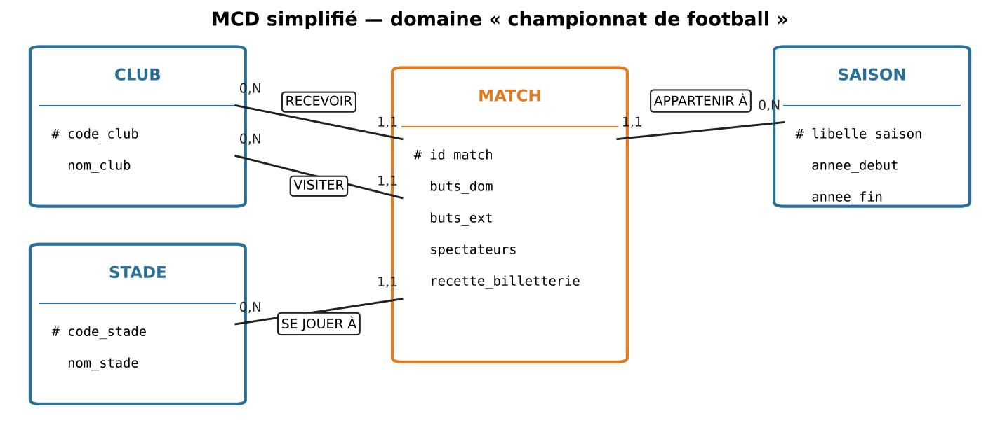
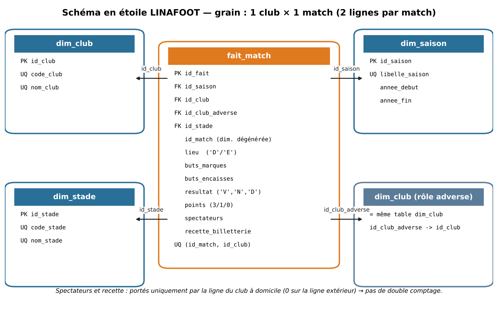
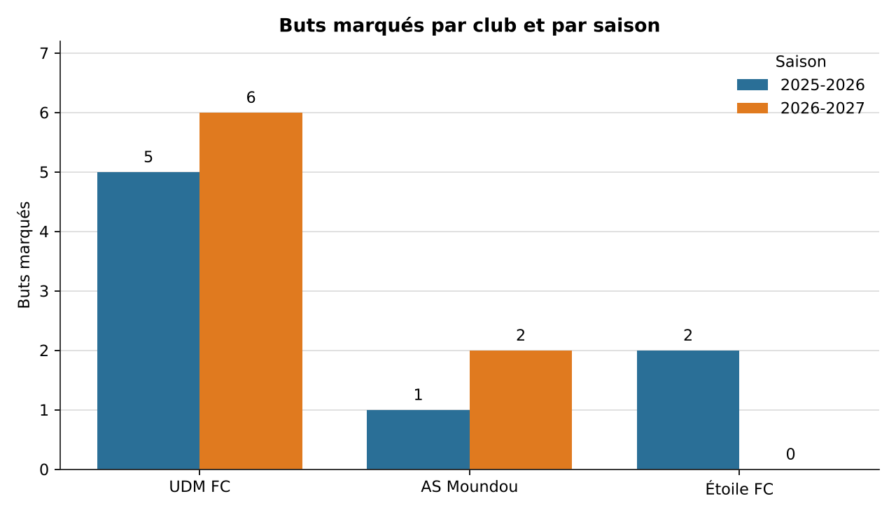
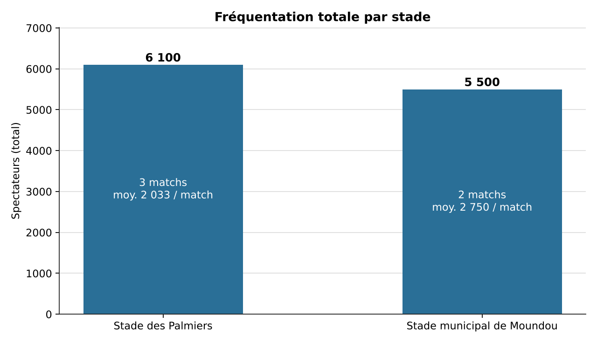

# ⚽ LINAFOOT Analytics – Entrepôt de données décisionnel

## 1. Présentation du projet

**LINAFOOT Analytics** est un projet de Business Intelligence consacré à la conception et au développement d'un entrepôt de données décisionnel permettant d'analyser les performances d'une ligue de football.

Le projet repose sur la mise en œuvre d'une chaîne **ETL (Extract, Transform, Load)** avec Python et Pandas, ainsi que sur la création d'un entrepôt de données sous PostgreSQL selon une modélisation dimensionnelle en étoile.

L'objectif est de centraliser les données relatives aux clubs, aux matchs et aux stades afin de faciliter leur exploitation et de produire des indicateurs utiles à l'analyse des performances sportives et économiques.

## 2. Objectifs du projet

Ce projet vise principalement à :

- Collecter et centraliser les données provenant de plusieurs fichiers CSV.
- Nettoyer, contrôler et transformer les données avant leur intégration.
- Concevoir un entrepôt de données adapté à l'analyse décisionnelle.
- Mettre en place une chaîne ETL automatisée avec Python et Pandas.
- Exploiter les données avec des requêtes SQL.
- Analyser les performances des clubs, les résultats des matchs, la fréquentation des stades et les recettes de billetterie.
- Produire des représentations graphiques facilitant l'interprétation des résultats.

## 3. Architecture décisionnelle

L'architecture du projet s'articule autour de trois grandes étapes :

1. **Extraction :** lecture des fichiers CSV contenant les informations sur les clubs, les stades et les matchs.
2. **Transformation :** nettoyage, validation, détection des doublons et contrôle de cohérence des données.
3. **Chargement :** intégration des données transformées dans l'entrepôt PostgreSQL.

### Modèle conceptuel de données (MCD)



### Modèle dimensionnel en étoile

L'entrepôt de données repose sur un schéma en étoile constitué de dimensions descriptives et d'une table de faits.



**Dimensions :**
- `dim_club` : informations relatives aux clubs.
- `dim_saison` : informations relatives aux saisons sportives.
- `dim_stade` : informations relatives aux stades.

**Table de faits :**
- `fait_match` : centralise les mesures relatives aux matchs, notamment les buts marqués, les buts encaissés, les résultats, les spectateurs et les recettes.

Chaque match est représenté par deux lignes dans la table de faits : une pour le club à domicile et une pour le club à l'extérieur. Les données de fréquentation et de billetterie sont associées à la ligne du club à domicile afin d'éviter le double comptage.

## 4. Technologies et outils utilisés

| Technologie | Utilisation |
|---|---|
| Python | Développement de la chaîne ETL |
| Pandas | Manipulation, nettoyage et transformation des données |
| SQL | Création et interrogation de l'entrepôt |
| PostgreSQL | Système de gestion de base de données |
| SQLAlchemy | Connexion entre Python et PostgreSQL |
| Matplotlib / visualisations PNG | Restitution graphique des analyses |

## 5. Structure du dépôt

```text
ETL-Football-Data-Warehouse/
│
├── etl.py
├── Code python.py
├── schema.sql
├── analyses.sql
│
├── clubs.csv
├── stades.csv
├── matchs.csv
├── rejets_etl.csv
│
├── mcd.png
├── schema_etoile.png
├── graphique_buts_par_club.png
├── graphique_frequentation_par_stade.png
│
└── README.md
```

**Description des principaux fichiers :**

- `etl.py` : script principal de la chaîne ETL.
- `Code python.py` : script Python complémentaire.
- `schema.sql` : création du schéma décisionnel et des tables PostgreSQL.
- `analyses.sql` : requêtes SQL destinées à l'exploitation des données.
- `clubs.csv`, `stades.csv`, `matchs.csv` : fichiers sources.
- `rejets_etl.csv` : fichier de suivi des données rejetées par le traitement ETL.
- `mcd.png` : représentation du modèle conceptuel de données.
- `schema_etoile.png` : représentation de la modélisation dimensionnelle.
- `graphique_buts_par_club.png` : visualisation des buts par club.
- `graphique_frequentation_par_stade.png` : visualisation de la fréquentation par stade.

## 6. Installation et configuration

### Prérequis

Avant de lancer le projet, il faut disposer de :

- Python 3.x
- PostgreSQL
- pip

### Étape 1 : Récupérer le projet

```bash
git clone https://github.com/carmel-data/ETL-Football-Data-Warehouse.git
```

Accéder ensuite au répertoire :

```bash
cd ETL-Football-Data-Warehouse
```

### Étape 2 : Installer les dépendances

```bash
pip install pandas sqlalchemy psycopg2-binary
```

### Étape 3 : Préparer la base de données

Créer une base de données PostgreSQL nommée :

```text
linafoot_sid
```

Exécuter ensuite le script `schema.sql` pour créer le schéma décisionnel `dw_football` et ses tables.

### Étape 4 : Configurer la connexion

Configurer les paramètres de connexion PostgreSQL dans le script `etl.py` :

- Hôte : `localhost`
- Port : `5432`
- Base de données : `linafoot_sid`
- Schéma : `dw_football`
- Utilisateur : votre utilisateur PostgreSQL.

**Important :** le mot de passe doit être fourni de manière sécurisée, par exemple avec une variable d'environnement. Ne jamais publier un mot de passe réel dans le dépôt GitHub.

### Étape 5 : Exécuter la chaîne ETL

Après configuration de la connexion et vérification de la présence des trois fichiers CSV dans le même répertoire que `etl.py`, lancer :

```bash
python etl.py
```

### Étape 6 : Effectuer les analyses SQL

Une fois les données chargées, exécuter les requêtes du fichier :

```text
analyses.sql
```

Ces requêtes permettent d'exploiter les données intégrées dans l'entrepôt décisionnel.

## 7. Résultats et visualisations

Le projet comprend plusieurs supports graphiques permettant d'illustrer les données analysées.

### Analyse des buts par club



### Analyse de la fréquentation des stades



## 8. Compétences mobilisées

La réalisation de ce projet a permis de mettre en pratique plusieurs compétences en informatique décisionnelle et en Data Engineering :

- Conception et modélisation d'un entrepôt de données.
- Développement d'une chaîne ETL.
- Préparation et qualité des données.
- Manipulation de données avec Python et Pandas.
- Administration et interrogation d'une base PostgreSQL.
- Modélisation dimensionnelle en étoile.
- Exploitation décisionnelle avec SQL.
- Visualisation et interprétation des données.

## 9. Auteur

**Carmel MBAIHONDOUM SINGAMONGUE**

Étudiant en Informatique Décisionnelle / Data Science.

GitHub : [carmel-data](https://github.com/carmel-data)

---

*Projet académique réalisé dans le cadre de la mise en pratique des concepts de Business Intelligence, de Data Engineering et de conception d'entrepôts de données.*
